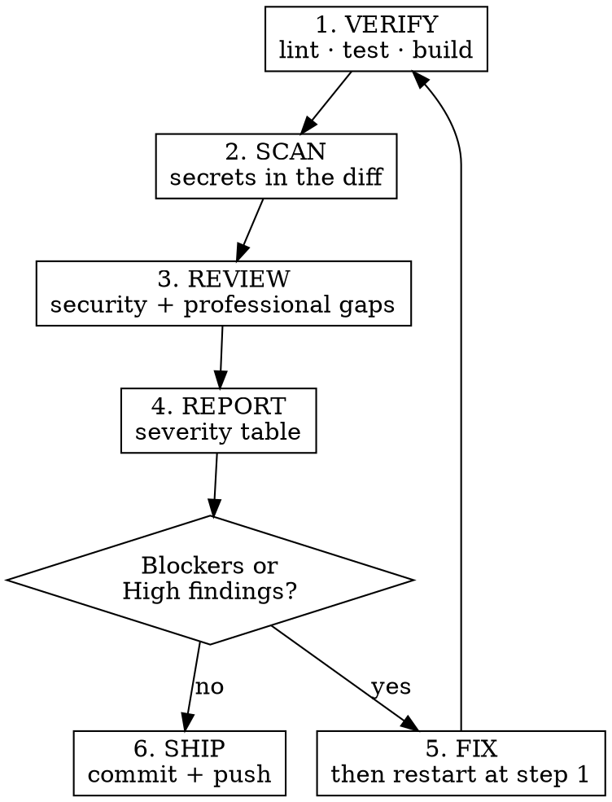

# Ship Review

Gate between "code written" and "code pushed". Nothing reaches CI until it passes.

**Core principle:** Evidence before assertions. Never report a check as passing without the command output in front of you.

## The Gate — run in order, stop at first failure



**Restarting at step 1 after a fix is not optional.** A fix that breaks a test is worse than the finding it fixed.

## 1. Verify

```bash
npm run lint && npm run test && npm run build
```

Paste real output. "Tests pass" without output is not a verification, it is a guess.

## 2. Scan the diff for secrets

```bash
git diff --cached --name-only          # what is actually staged
git diff --cached | grep -inE "(secret|password|token|api[_-]?key|private[_-]?key)\s*[=:]\s*['\"][^'\"]{8,}"
```

Look at the *contents* of anything suspicious, even when the filename looks innocent. `.env` must never appear in the staged list.

## 3. Review the diff

Read the full diff, then work through **checklist.md** in this folder. It covers this project's actual risk surface (auth, Prisma, uploads, payments, RBAC, money) and the production-readiness gaps that separate a demo from a real store.

Only report what you can point at in the diff. A finding needs a file, a line, and a concrete failure scenario — inputs or state that produce the wrong result. If you cannot describe how it breaks, it is a preference, not a finding.

## 4. Report

| Severity | Meaning | Blocks push? |
|---|---|---|
| **Blocker** | Data loss, auth bypass, money wrong, secret exposed | Yes |
| **High** | Exploitable or breaks a real user flow | Yes |
| **Medium** | Works but will hurt at scale or in production | No — log it |
| **Low** | Style, naming, small cleanups | No |

Format each finding as: `severity · file:line · what breaks · how it breaks · fix`.

Say plainly when the diff is clean. Inventing findings to look thorough wastes the user's time.

## 5. Fix

Fix Blockers and High findings now. Medium and Low go into `docs/plans/PROGRESS.md` under the current phase so they are not silently dropped.

For behavior changes, write the failing test first — the same rule the rest of this repo follows.

## 6. Ship

Only after the gate is green:

```bash
git add -A && git status --short      # look at this list before committing
git commit -F -                        # Conventional Commits, no AI attribution
git push
```

Commits carry no `Co-Authored-By` or "Generated with" line — see CLAUDE.md.

Confirm the push, then check that GitHub Actions went green. A push is not "done" until CI agrees.

## Red flags — you are about to skip the gate

| Thought | Reality |
|---|---|
| "Small change, skip the tests" | Small changes break builds. The command takes a minute. |
| "Tests passed earlier" | Earlier was a different diff. Run them again. |
| "I'll fix the security thing next phase" | Next phase builds on top of it. Cost only goes up. |
| "It's just a demo" | This platform takes real payments. It is not a demo. |
| "CI will catch it" | CI catches broken builds, not auth bypass or leaked keys. |
| "No findings, so I'll pad the report" | An honest "clean" is more useful than invented findings. |
